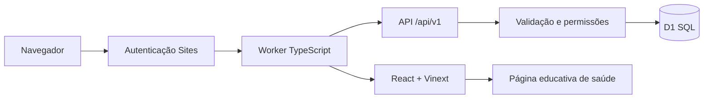

# Arquitetura — WALK TALK Empresas

## Front-end e back-end

A apresentação original permanece em `/`. O portal `/portal` é uma aplicação de gestão com componentes React, formulários controlados e requisições JSON. A página `/saude` é conteúdo informativo independente, também acessível pela navegação interna do portal.

O Vinext mantém a construção sobre Vite, adicionando renderização no servidor e empacotamento para Cloudflare Workers. O `worker/index.ts` encaminha `/api/v1/*` ao handler de domínio e entrega as outras rotas ao Vinext. Assets públicos são servidos pelo binding ASSETS.

## Identidade e empresas

Sites autentica visitantes e injeta os cabeçalhos `oai-authenticated-user-*`. Esses cabeçalhos são confiáveis somente atrás da infraestrutura Sites; não exponha este Worker diretamente em outro domínio sem autenticação equivalente que remova cabeçalhos fornecidos pelo cliente.

O ID fornecido pela plataforma é a chave de usuário. No primeiro acesso, não se cria empresa automaticamente. Uma ação explícita cria empresa e administrador em um batch transacional. A versão atual permite uma empresa por conta e um administrador fundador por empresa. Convites adicionam gestores ou colaboradores.

A autorização está no servidor. Esconder botões melhora a interface, mas não concede nem revoga permissão. Consultas e alterações sempre são limitadas por `workspace_id`. Referências a equipes e responsáveis de outra empresa são rejeitadas.

| Perfil | Equipamentos | Equipes e pessoas | Conversas | Convites e perfis |
| --- | --- | --- | --- | --- |
| Administrador | Cadastra, edita, verifica, arquiva e exporta | Cria equipes e organiza membros | Geral e todas as equipes da empresa | Cria/revoga convites e altera gestor/colaborador |
| Gestor | Cadastra, edita, verifica, arquiva e exporta | Cria equipes e consulta membros | Geral e todas as equipes da empresa | Sem acesso administrativo |
| Colaborador | Consulta aparelhos atribuídos ou de sua equipe; verifica apenas os atribuídos a si | Consulta pessoas/equipe autorizadas | Geral e equipe à qual pertence | Sem acesso administrativo |

O administrador fundador não pode remover o próprio perfil por essa interface. Convites são tokens aleatórios com hash SHA-256 no banco, validade de sete dias e aceitação de uso único. O token bruto só é retornado na criação. É possível vincular a aceitação a um e-mail; caso contrário, qualquer conta autenticada com acesso ao link e ao Site poderá aceitar.

O convite do aplicativo não modifica a audiência da hospedagem. Para admitir outras pessoas, o proprietário também precisa conceder acesso ao Site pelo controle de compartilhamento da plataforma. O aplicativo não envia e-mails automaticamente.

## Dados

As tabelas são `workspaces`, `members`, `teams`, `devices`, `messages`, `invitations` e `activity`. `db/schema.ts` é a definição Drizzle; os arquivos `drizzle/*.sql` são migrações versionadas. Não se cria schema durante uma requisição. Exemplos fictícios são inseridos somente por opção explícita no cadastro da empresa e recebem a marca `isExample`.

Equipamentos têm nome, série/patrimônio, modelo, status operacional, equipe, responsável, observação e última verificação manual. Arquivar remove o aparelho da lista ativa e preserva o registro. Série é única dentro da empresa, inclusive para aparelhos arquivados. Verificar é um registro humano: não consulta bateria, localização ou sinal de um rádio.

Mensagens são texto puro, associadas a autor e canal. A interface consulta atualizações a cada 30 segundos quando visível; não promete tempo real. Os 100 registros mais recentes por canal são exibidos. Outros limites de listagem: 1.000 aparelhos ativos, 250 equipes, 500 membros e 250 convites. As métricas do dashboard e a exportação CSV consideram todo o conjunto autorizado; a exportação usa páginas para não carregar o inventário inteiro em memória. Para volumes maiores, a próxima evolução é paginação navegável nas telas.

Datas são persistidas em UTC. A interface apresenta datas no fuso do navegador; a contagem de verificações de hoje usa o dia UTC no servidor.

## Fronteiras de segurança

- API exige identidade e autoriza o perfil a cada operação.
- Escritas JSON validam origem, tipo de conteúdo, tamanho e campos permitidos.
- SQL parametrizado e batches transacionais nas operações relacionadas.
- API responde com `Cache-Control: private, no-store` e não retorna hashes de convites.
- CSV neutraliza fórmulas que começariam por caracteres especiais.
- A PWA nunca guarda respostas da API, contas, conversas ou HTML do portal no cache offline.
- O checklist educativo de saúde existe somente no estado React e desaparece ao recarregar. Não há tabelas ou endpoints de dados clínicos.

## Limites operacionais

Esta entrega não inclui conexão com aparelhos físicos, satélites, canais de emergência, telemetria, notificações push, envio de e-mail, recuperação de histórico arquivado na interface ou integração com prontuários. Em escala de produção, configure retenção, rotinas de backup, acompanhamento de erros e limites de uso adequados à sua operação no provedor. Isso não substitui a autenticação e autorização já implementadas.
